# VoIP Caller ID Spoofing Lab — Asterisk + MagnusBilling on Debian 11

> A self-hosted telephony research lab that demonstrates **how Caller ID (CLI) is forged over SIP**, why legacy VoIP trusts it blindly, and **how modern networks defend against it** with STIR/SHAKEN, SIP over TLS, and carrier-side validation.

<p align="center">
  
  
  
  
  
  
</p>

---

## ⚠️ Legal & Ethical Notice — Read First

Caller ID spoofing is **illegal in most jurisdictions when used to defraud, deceive, or cause harm** — for example under the U.S. *Truth in Caller ID Act (47 U.S.C. § 227(e))*, the UK *Communications Act 2003*, and India's *TRAI / Indian Telegraph Act* rules.

This repository documents a **private, isolated study lab** built to understand a well-known weakness in the SIP protocol **for defensive and educational purposes only**. It contains **no live services, no real subscriber data, no credentials, and no targeting instructions.**

- ✅ Operate only on infrastructure **you own**, with endpoints and numbers **you control**.
- ✅ Use it to learn protocol internals, build detection logic, and test countermeasures.
- ❌ **Never** place spoofed calls to third parties, impersonate real entities, or bypass carrier controls on production networks.

By using anything here you accept **full responsibility** for complying with the laws that apply to you. See [`DISCLAIMER.md`](DISCLAIMER.md).

---

## 📖 Overview

This project walks through standing up a complete **VoIP telephony stack** on a single Debian 11 VPS and uses it as a controlled environment to study **Caller Line Identification (CLI) spoofing** — the practice of presenting an arbitrary number to the called party.

The stack is intentionally built from the ground up so every layer is visible:

| Layer | Component | Role |
|-------|-----------|------|
| Transport | **SIP / RTP** | Session signalling & media |
| PBX core | **Asterisk** (compiled from source) | Call routing, dialplan, codec negotiation |
| Management | **MagnusBilling** | Web UI for SIP users, trunks, rates, routes, CDR |
| OS | **Debian 11 (Bullseye)** | Hardened host on a VPS |
| Clients | **MicroSIP / Zoiper / PortSIP / MizuDroid** | Softphone endpoints |

The central lesson: **in legacy SIP the Caller ID is just a text field set by the originating endpoint.** There is no built-in cryptographic proof that the caller owns the number — which is exactly why STIR/SHAKEN and TLS-secured signalling exist. This lab makes that gap tangible and then shows how to close it.

<p align="center">
  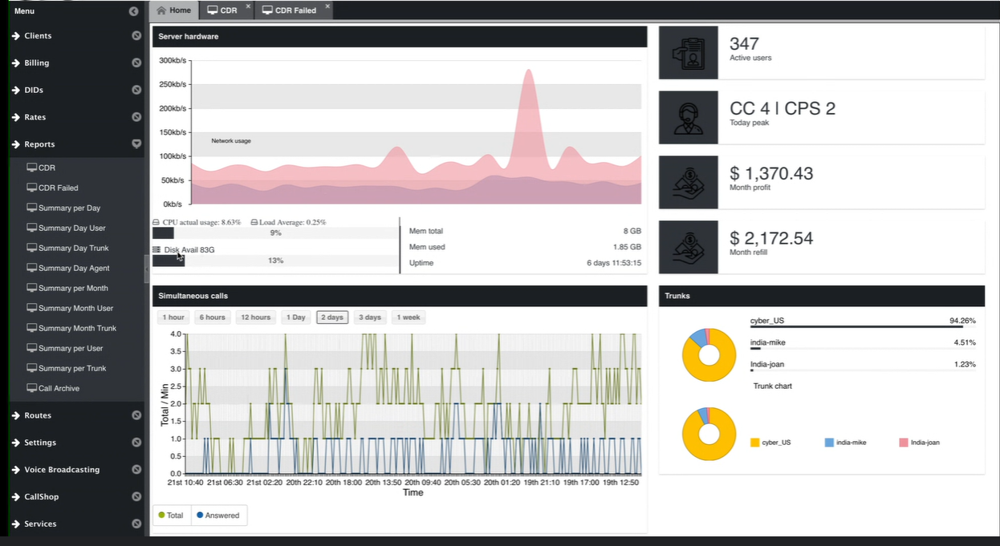
  <br>
  <sub>MagnusBilling monitoring dashboard — live channels, CPS, server load, and per-trunk distribution.</sub>
</p>

---

## 🗂️ Repository Structure

```
.
├── README.md                         ← you are here
├── DISCLAIMER.md                     ← legal & ethical terms
├── LICENSE                           ← MIT (code/docs only)
├── .gitignore
├── docs/
│   ├── 01-architecture.md            ← system design & call flow
│   ├── 02-installation.md            ← Debian + Asterisk + MagnusBilling build
│   ├── 03-configuration.md           ← SIP users, trunks, rates, routes
│   ├── 04-callerid-spoofing-mechanics.md  ← why/how CLI is forgeable in SIP
│   ├── 05-sip-traffic-analysis.md    ← reading SIP headers with Wireshark
│   ├── 06-defenses-and-countermeasures.md ← STIR/SHAKEN, TLS, hardening
│   └── 07-softphone-clients.md       ← endpoint setup & codecs
└── assets/
    └── screenshots/                  ← annotated lab screenshots (sanitised)
```

---

## 🚀 Quick Start (Documentation Path)

Read the docs in order:

1. **[Architecture](docs/01-architecture.md)** — how the pieces fit and how a call flows end to end.
2. **[Installation](docs/02-installation.md)** — build Asterisk from source and install MagnusBilling on Debian 11.
3. **[Configuration](docs/03-configuration.md)** — create SIP users, trunks, prefixes, rates, and routes.
4. **[Caller ID Spoofing Mechanics](docs/04-callerid-spoofing-mechanics.md)** — the protocol-level reason CLI can be forged.
5. **[SIP Traffic Analysis](docs/05-sip-traffic-analysis.md)** — inspect `INVITE` headers and media with Wireshark.
6. **[Defenses & Countermeasures](docs/06-defenses-and-countermeasures.md)** — the part that matters most.
7. **[Softphone Clients](docs/07-softphone-clients.md)** — register endpoints and negotiate codecs.

---

## 🎯 What This Lab Demonstrates

- **End-to-end VoIP engineering** — compiling Asterisk, wiring SIP trunks, and managing a dialplan.
- **The SIP trust model** — how the `From` / `P-Asserted-Identity` headers carry caller identity and where that trust breaks.
- **Protocol forensics** — capturing and dissecting SIP signalling and RTP media with Wireshark.
- **Billing & routing logic** — prefixes, tariffs, rates, and call-detail records (CDR) in MagnusBilling.
- **Defensive engineering** — what STIR/SHAKEN attestation, SIP/TLS + SRTP, and carrier validation actually do.

## 🧠 Skills Applied

`Linux server administration` · `Asterisk / PBX` · `SIP & RTP internals` · `VoIP security`
`Network traffic analysis (Wireshark)` · `Telecom fraud & countermeasures` · `MagnusBilling`

---

## 🛡️ Why Study This Defensively?

Caller ID spoofing underpins a huge share of modern phone fraud — vishing, "neighbor-spoofing" robocalls, bank-impersonation scams, and SIM-swap social engineering. You cannot build effective detection, carrier policy, or STIR/SHAKEN tooling without first understanding **exactly how the forgery works at the SIP layer.** This lab exists to produce that understanding and channel it into defense. The final and most important document in this repo is [Defenses & Countermeasures](docs/06-defenses-and-countermeasures.md).

---

## 🖼️ Gallery

### Setup & Installation

<table>
  <tr>
    <td align="center" width="50%"><a href="assets/screenshots/asterisk-source-compilation.png">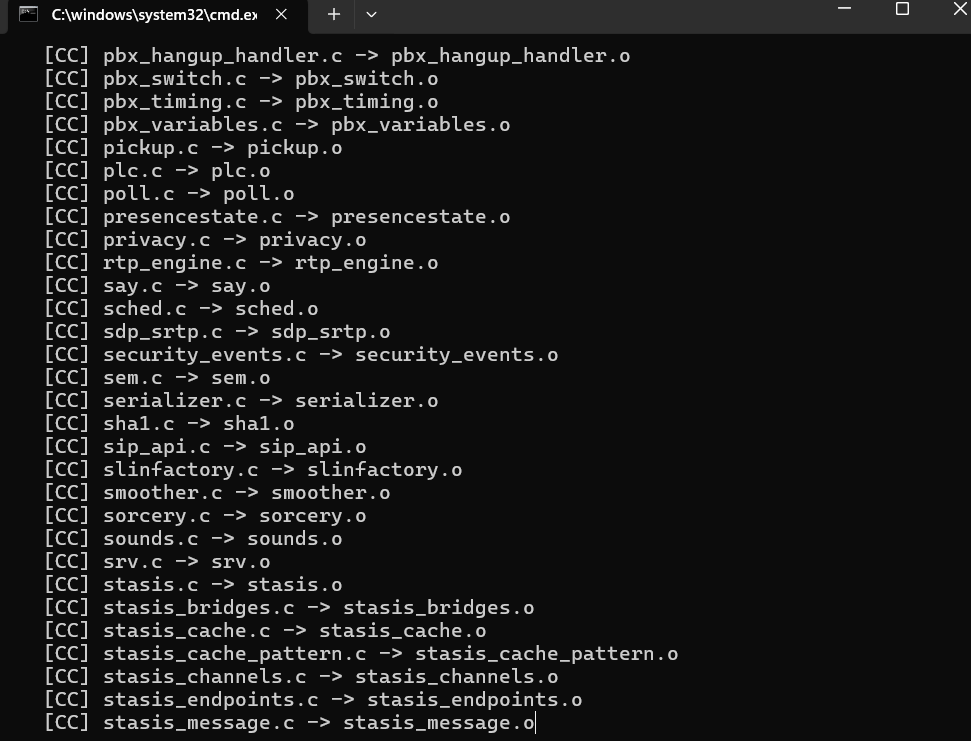</a><br><sub><b>Asterisk compiled from source</b></sub></td>
    <td align="center" width="50%"><a href="assets/screenshots/magnusbilling-update-download.png">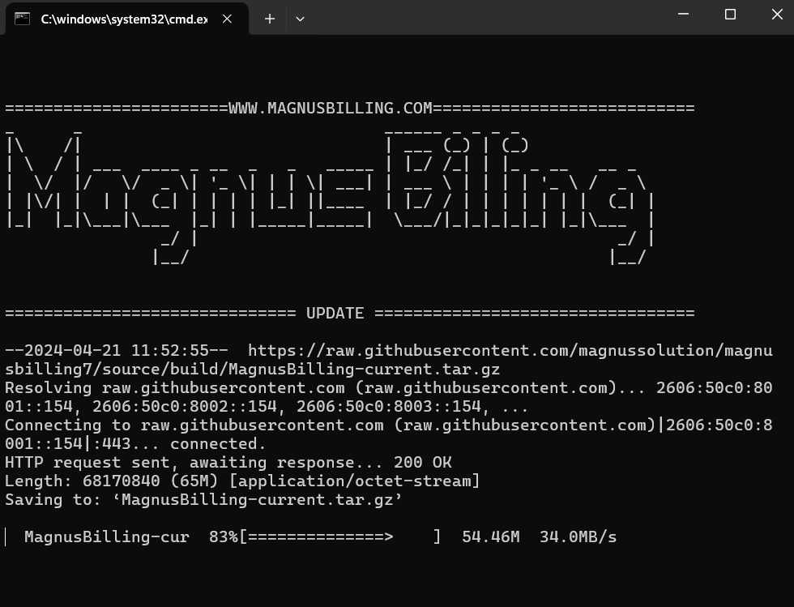</a><br><sub><b>MagnusBilling download</b></sub></td>
  </tr>
  <tr>
    <td align="center" width="50%"><a href="assets/screenshots/installation-success-result.png">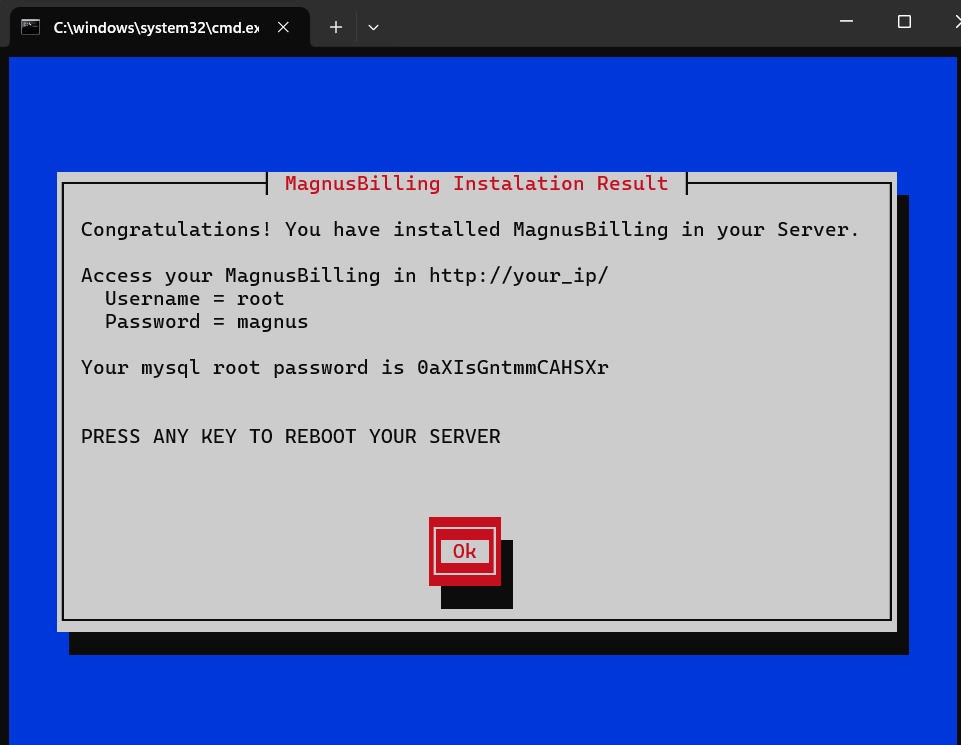</a><br><sub><b>Installation result</b></sub></td>
    <td align="center" width="50%"><a href="assets/screenshots/magnusbilling-language-selection.png">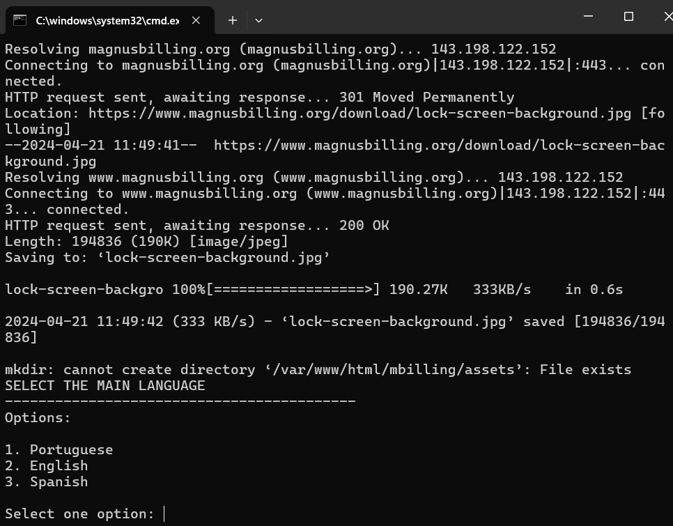</a><br><sub><b>Language selection</b></sub></td>
  </tr>
</table>

<p align="center">
  <a href="assets/screenshots/debian-perl-dependencies.png">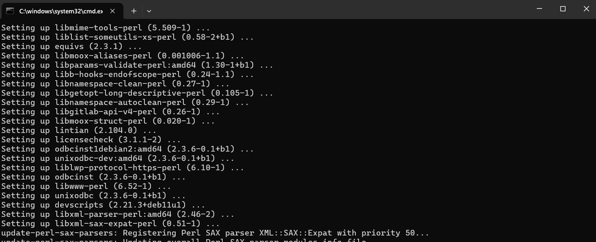</a><br>
  <sub><b>Perl / ODBC dependencies installed on Debian 11</b></sub>
</p>

<p align="center">
  <a href="assets/screenshots/libvpb1-country-code-config.png">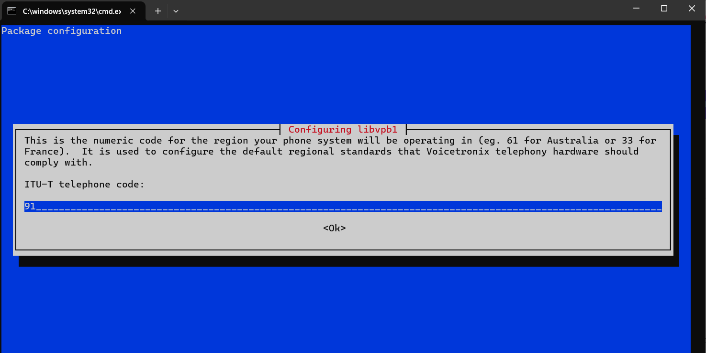</a><br>
  <sub><b>libvpb1 — ITU-T regional telephone code</b></sub>
</p>

<p align="center">
  <a href="assets/screenshots/mbilling-folder-contents.png">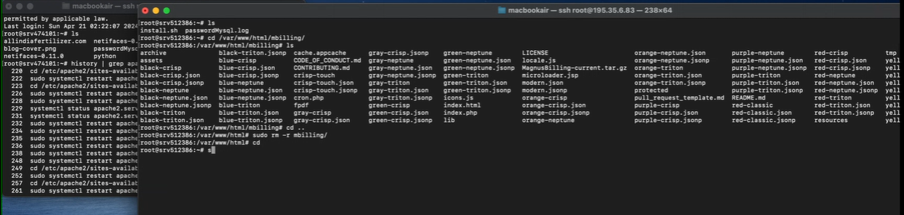</a><br>
  <sub><b>MagnusBilling application folder</b> </sub>
</p>

### Configuration & Operation

<p align="center">
  <a href="assets/screenshots/client-user-management.png">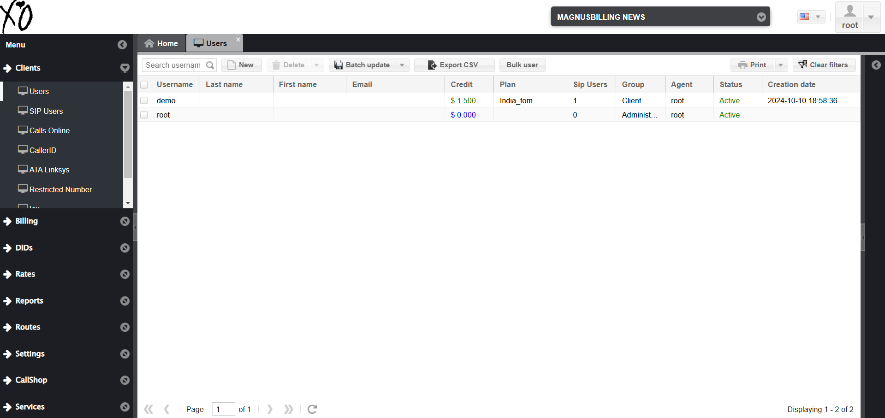</a><br>
  <sub><b>Client / user management</b></sub>
</p>

<p align="center">
  <a href="assets/screenshots/sip-user-codec-config.png">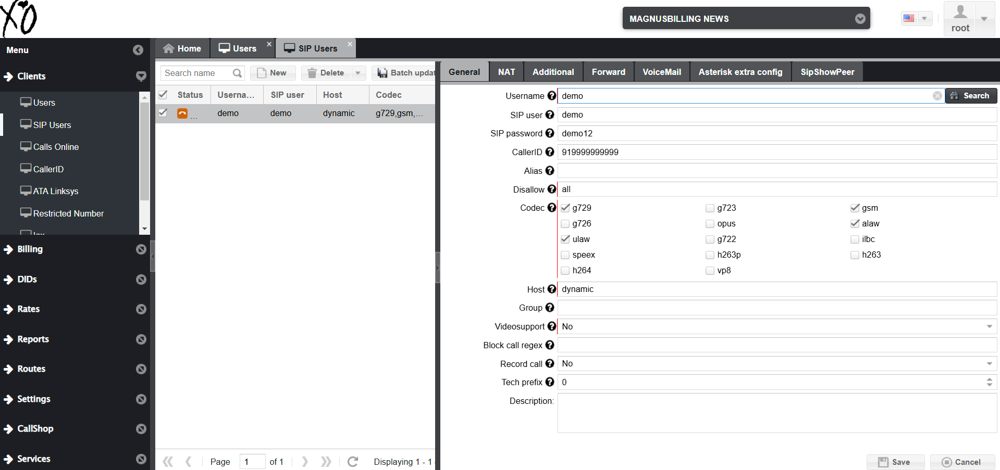</a><br>
  <sub><b>SIP user — CallerID field & codec negotiation</b></sub>
</p>

<p align="center">
  <a href="assets/screenshots/dial-prefix-rate-routing.png">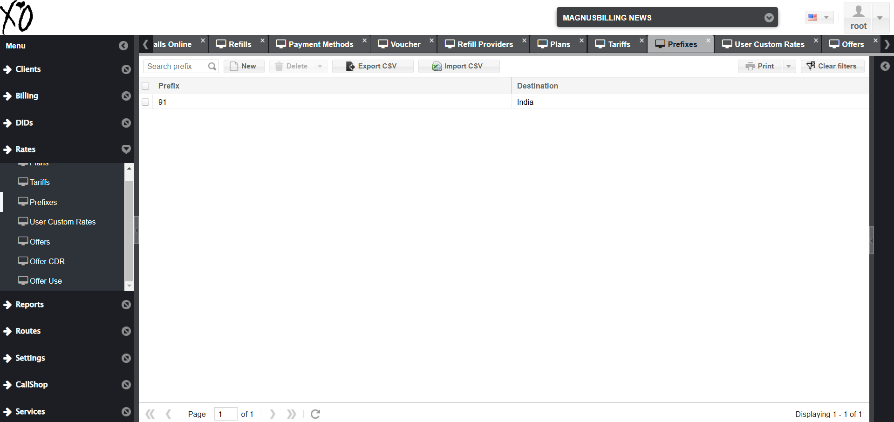</a><br>
  <sub><b>Dial prefix → destination routing</b></sub>
</p>

<p align="center">
  <a href="assets/screenshots/call-detail-records-cdr.png">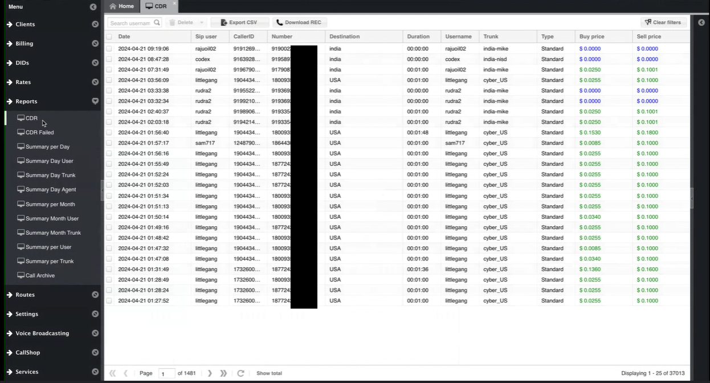</a><br>
  <sub><b>Call Detail Records (CDR)</b> </sub>
</p>

<p align="center">
  <a href="assets/screenshots/magnusbilling-admin-dashboard.png">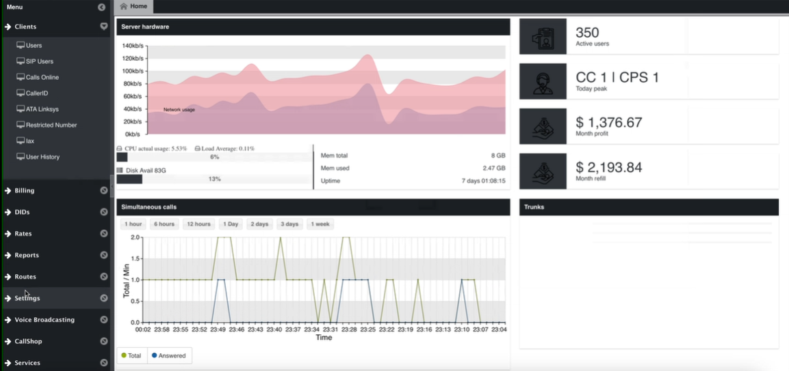</a><br>
  <sub><b>Admin dashboard</b> </sub>
</p>

### Email Notifications

<p align="center">
  <a href="assets/screenshots/hostinger-imap-smtp-setup.png">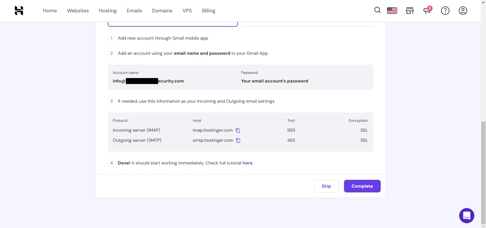</a><br>
  <sub><b>IMAP / SMTP settings</b></sub>
</p>

<p align="center">
  <a href="assets/screenshots/hostinger-pop3-setup.png">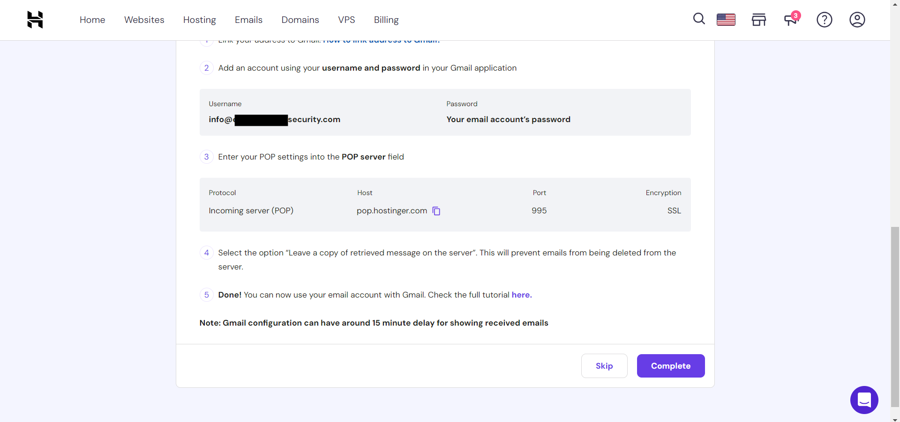</a><br>
  <sub><b>POP3 settings</b></sub>
</p>

---

## 📚 References

- [Asterisk Documentation](https://docs.asterisk.org/)
- [MagnusBilling (official)](https://magnusbilling.org/) · [GitHub](https://github.com/magnusbilling/mbilling)
- [RFC 3261 — SIP: Session Initiation Protocol](https://www.rfc-editor.org/rfc/rfc3261)
- [RFC 8224 — Authenticated Identity Management in SIP](https://www.rfc-editor.org/rfc/rfc8224) (STIR)
- [RFC 8588 — SHAKEN: PASSporT Extension](https://www.rfc-editor.org/rfc/rfc8588)
- [FCC — STIR/SHAKEN & Caller ID Spoofing](https://www.fcc.gov/call-authentication)

---

## 📄 License

Documentation and configuration examples are released under the [MIT License](LICENSE). Third-party software (Asterisk, MagnusBilling) remains under its own license. This license grants **no permission** to use the material for unlawful activity — see [`DISCLAIMER.md`](DISCLAIMER.md).

---

<p align="center"><sub>Built as a cybersecurity learning project. Understand the attack — build the defense.</sub></p>
